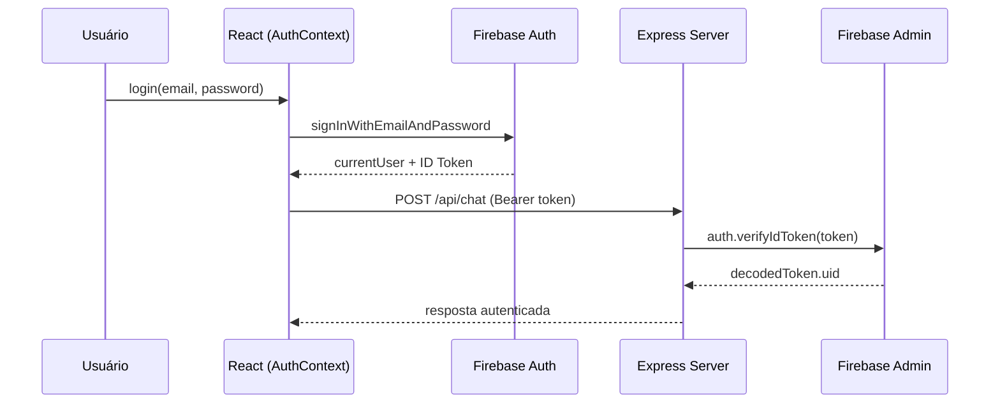

# 🗺️ Facul Mind — Mapa do Projeto

> Gerado em: 2026-11-12 | ~9.350 LOC (sem node_modules)

---

## O que é

Plataforma SaaS B2B para IES (foco UFPE). Dois modos:
1. **Universitário** — assistente virtual Agy, anti-evasão, ouvidoria anônima, jogos terapêuticos, sala virtual 3D, radar de oportunidades
2. **Empresarial** — multi-agentes IA para PMEs (organograma, fluxos BPMN, SWOT/5W2H, geração de atas/SOPs)

---

## Stack

| Camada | Tech |
|---|---|
| Frontend | React 18 + TypeScript + Tailwind CSS + Lucide Icons |
| Build | Vite 6 (porta 3000, proxy `/api` → 3001) |
| Backend | Node.js + Express (porta 3001) |
| IA | Google Gemini 1.5 Flash via `@google/generative-ai` |
| Auth | Firebase Auth (client) + Firebase Admin SDK (server) |
| DB | Firestore (real-time sync) + JSON in-memory store (fallback) |
| Scraping | Puppeteer + Cheerio (SIGAA UFPE) |
| Áudio/Canvas | Web Audio API (528Hz), HTML5 Canvas |
| Efeitos | canvas-confetti, CSS keyframes |

---

## Estrutura de Diretórios

```
faculmind/
├── server/                      # Backend Node/Express
│   ├── index.js                 # Entry (482 LOC) — rotas REST, auth middleware
│   ├── agents/
│   │   └── orchestrator.js      # Multi-agent router (591 LOC)
│   ├── config/
│   │   └── firebaseAdmin.js     # Firebase Admin SDK init (36 LOC)
│   ├── data/
│   │   └── store.js             # In-memory data + Firestore sync (837 LOC)
│   └── services/
│       ├── sigaaScraper.js      # Puppeteer scraper SIGAA (155 LOC)
│       └── sigaaParser.js       # Cheerio HTML parser (232 LOC)
│
├── src/                         # Frontend React/TS
│   ├── main.tsx                 # ReactDOM entry (13 LOC)
│   ├── App.tsx                  # Root — tabs, auth, chat modal (233 LOC)
│   ├── types/index.ts           # TypeScript interfaces (239 LOC)
│   ├── index.css                # Tailwind base
│   ├── vite-env.d.ts
│   │
│   ├── context/
│   │   ├── AuthContext.tsx       # Firebase Auth provider (95 LOC)
│   │   └── ApiContext.tsx        # API factory provider (27 LOC)
│   │
│   ├── services/
│   │   ├── api.ts               # REST client — todas as rotas (372 LOC)
│   │   ├── ai_agent.ts          # Client-side Gemini fallback (62 LOC)
│   │   ├── firebase.ts          # Firebase client SDK init (227 LOC)
│   │   └── sound.ts             # Web Audio synth — sinos, pops (152 LOC)
│   │
│   └── components/
│       ├── common/
│       │   └── Navbar.tsx                   # Nav + tabs (233 LOC)
│       ├── chat/
│       │   └── FaculMindChatModal.tsx       # Chat modal c/ agentes (468 LOC)
│       ├── academic/
│       │   ├── AcademicPortal.tsx           # Portal do aluno (575 LOC)
│       │   ├── SigaaSyncModal.tsx           # Sync SIGAA (414 LOC)
│       │   ├── VirtualRoom3D.tsx            # Sala Virtual 3D (424 LOC)
│       │   ├── OmbudsmanModal.tsx           # Ouvidoria anônima (390 LOC)
│       │   ├── OpportunitiesFeed.tsx        # Radar oportunidades (319 LOC)
│       │   ├── RadarPermanenciaModal.tsx    # Termômetro humor (267 LOC)
│       │   └── ClinicAppointmentModal.tsx   # Clínica Psicologia (196 LOC)
│       ├── relax/
│       │   ├── PausaMindHub.tsx             # Hub jogos (107 LOC)
│       │   ├── ZenGardenCanvas.tsx          # Jardim Zen (239 LOC)
│       │   ├── ColoringBook.tsx             # Colorir (227 LOC)
│       │   ├── MemoryGame.tsx              # Jogo memória (142 LOC)
│       │   └── BubblePopGame.tsx            # Estoure bolhas (141 LOC)
│       ├── institutional/
│       │   └── DashboardCoordinator.tsx     # Painel gerencial (451 LOC)
│       └── enterprise/
│           └── EnterprisePlatform.tsx       # Plataforma PMEs (1004 LOC)
│
├── public/                      # Assets estáticos (mascot, previews)
├── .env                         # Chaves (Firebase, Gemini, SIGAA)
├── package.json                 # Deps e scripts
├── vite.config.ts               # Vite + proxy
├── tailwind.config.js
├── tsconfig.json
├── postcss.config.js
├── plano_negocios.txt           # Plano de negócios SEBRAE
├── networking_tech.txt          # Pitch/ideário original
└── *.pdf / *.jpeg / *.jpg       # Materiais visuais e docs PDF
```

---

## Agentes IA (server/agents/orchestrator.js)

O orchestrator roteia por `agentId` ou intent (keywords na mensagem):

| Agente | ID | Função | Keywords |
|---|---|---|---|
| **Agy** | `agy-ufpe` | Assistente acadêmico UFPE. RAG com dados SIGAA reais | default |
| **FACUL ORGANIZA** | `facul-organiza` | Organograma, cargos, hierarquia | organograma, cargos, hierarquia |
| **FACUL FLUXO** | `facul-fluxo` | Processos, fluxogramas BPMN (Mermaid) | fluxo, processo, gargalo, bpmn |
| **FACUL ESTRATÉGIA** | `facul-estrategia` | Diagnóstico, SWOT cruzada, 5W2H | swot, 5w2h, estratégia, diagnóstico |
| **FACUL DOCS** | `facul-docs` | Atas, SOPs, checklists | ata, documento, checklist, procedimento |

Todos chamam Gemini 1.5 Flash com `systemInstruction` específica + contexto do estudante.

---

## Endpoints REST (server/index.js)

| Método | Rota | Auth | Descrição |
|---|---|---|---|
| GET | `/api/status` | ✗ | Health check + lista agentes |
| POST | `/api/chat` | ✓ | Mensagem → orchestrator → resposta IA |
| POST | `/api/sync-university` | ✓ | Scrape SIGAA (Puppeteer) + parser |
| GET | `/api/current-university-data` | ✓ | Dados acadêmicos do usuário autenticado |
| GET | `/api/notices` | ✓ | Avisos públicos UFPE |
| GET | `/api/opportunities` | ✓ | Feed oportunidades |
| POST | `/api/opportunities/:id/apply` | ✓ | Candidatura |
| GET | `/api/tickets` | ✓ | Ouvidoria — listar tickets |
| POST | `/api/tickets` | ✓ | Ouvidoria — criar ticket |
| POST | `/api/tickets/:id/respond` | ✓ | Ouvidoria — responder ticket |
| GET | `/api/clinic/appointments` | ✓ | Agendamentos clínica |
| POST | `/api/clinic/appointments` | ✓ | Novo agendamento |
| GET/POST | `/api/mural/*` | ✓ | Mural de post-its |
| GET/POST | `/api/coffee-chat/*` | ✓ | Chat em tempo real (salas temáticas) |
| POST | `/api/radar-permanencia` | ✓ | Registrar humor/permanência |
| GET | `/api/permanencia-stats` | ✓ | Estatísticas agregadas permanência |
| POST | `/api/enterprise/*` | ✓ | CRUD dados empresariais |

---

## Tabs no Frontend (App.tsx)

| Tab | Componente | Conteúdo |
|---|---|---|
| `academic` | `AcademicPortal` | Portal do aluno, SIGAA sync, avisos, modais |
| `opportunities` | `OpportunitiesFeed` | Estágios, bolsas, eventos, grupos |
| `pausa-mind` | `PausaMindHub` | 4 jogos terapêuticos |
| `virtual-room` | `VirtualRoom3D` | Mural, café, veteranos, noturno |
| `coordinator` | `DashboardCoordinator` | Métricas institucionais |
| `enterprise` | `EnterprisePlatform` | Multi-agentes empresariais |

---

## Fluxo de Autenticação



---

## Data Layer (server/data/store.js)

837 LOC. Dois modos:
1. **Firestore ativo** → lê/escreve coleções (`opportunities`, `tickets`, `appointments`, `mural`, `coffeeChat`, `academicRecords`, `permanenciaRecords`, `enterpriseState`)
2. **Fallback JSON** → `INITIAL_DATA` hardcoded com seed realista (vagas, turmas, eventos UFPE)

Dados acadêmicos (por UID) armazenados após scrape do SIGAA.

---

## Integração SIGAA

```
sigaaScraper.js (Puppeteer)
    → login no portal SIGAA UFPE
    → navega pelas páginas de turmas/notas
    → captura HTML bruto

sigaaParser.js (Cheerio)
    → parse HTML → StudentAcademicRecord
    → extrai: matrícula, CR, turmas, faltas, notas, horas complementares, alertas
```

---

## Tipos Principais (src/types/index.ts)

- `ActiveTab` — 6 tabs
- `StudentTurma` — disciplina, faltas, notas, docente, horário
- `StudentAcademicRecord` — matrícula, CR, turmas[], alertas[]
- `UniversityNotice`, `PostIt`, `CoffeeChatMessage`
- `Opportunity`, `Ticket`, `ClinicAppointment`
- `OrgNode`, `Workflow`, `SwotData`, `EnterpriseDocument`, `EnterpriseState`
- `ChecklistItem`, `PermanenciaStats`

---

## Como Rodar

```bash
npm install        # deps (já instaladas)
npm start          # backend :3001 + frontend :3000 (concurrently)
# ou separado:
npm run server     # backend
npm run dev        # frontend
```

Variáveis obrigatórias no `.env`: `GEMINI_API_KEY`, `VITE_FIREBASE_*`, `FIREBASE_ADMIN_*`

---

## Métricas de Código

| Área | Arquivos | LOC |
|---|---|---|
| Backend (`server/`) | 5 | 2.297 |
| Frontend (`src/`) | 21 | 7.053 |
| **Total** | **26** | **~9.350** |

Componente mais pesado: `EnterprisePlatform.tsx` (1.004 LOC) — plataforma multi-agentes empresarial completa.
