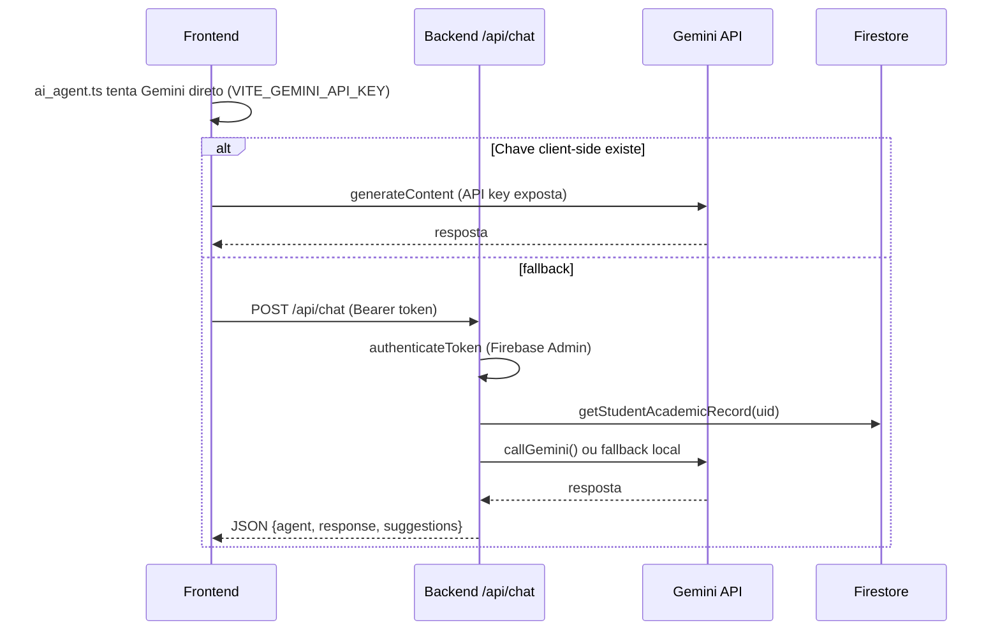
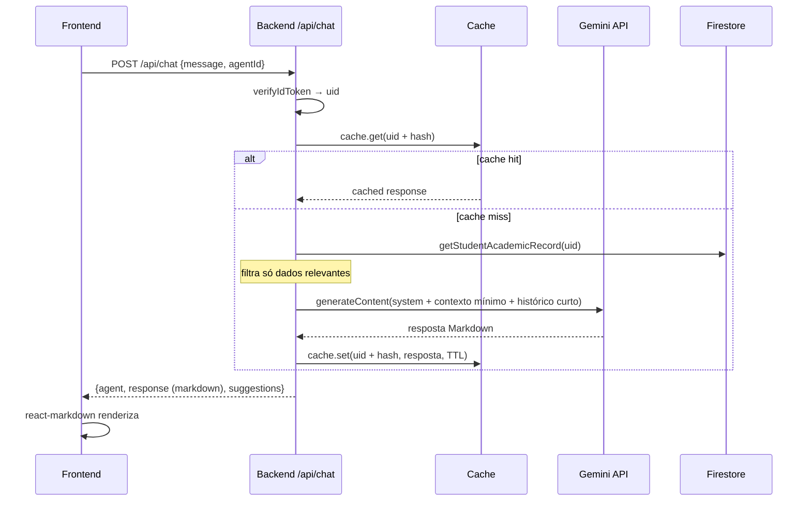

# Diagnóstico da Arquitetura do Agý — FaculMind

## Fluxo Atual

---

## Problemas Encontrados

### 🔴 P1 — API key Gemini exposta no frontend
[ai_agent.ts](file:///home/mariano/labs/programming-projects/faculmind/src/services/ai_agent.ts#L9) lê `VITE_GEMINI_API_KEY` e chama Gemini direto do browser. Key fica no bundle JS do client.

### 🔴 P2 — Duplicidade de prompts e lógica de IA
Dois system instructions distintos para o Agý:
- [ai_agent.ts L20-22](file:///home/mariano/labs/programming-projects/faculmind/src/services/ai_agent.ts#L20-L22) (frontend)
- [orchestrator.js L119-122](file:///home/mariano/labs/programming-projects/faculmind/server/agents/orchestrator.js#L119-L122) (backend)

Mantém dois fluxos paralelos fazendo a mesma coisa.

### 🟡 P3 — Agý depende de keywords quando Gemini falha
[orchestrator.js L145-382](file:///home/mariano/labs/programming-projects/faculmind/server/agents/orchestrator.js#L145-L382): fallback local usa `text.includes("nota")` etc. com respostas hardcoded. Sem Gemini key, o Agý é um chatbot de regex.

### 🟡 P4 — Contexto inteiro enviado ao modelo
[orchestrator.js L30-36](file:///home/mariano/labs/programming-projects/faculmind/server/agents/orchestrator.js#L30-L36): `JSON.stringify(contextData)` serializa tudo, incluindo oportunidades irrelevantes para a pergunta.

### 🟡 P5 — Zero cache de respostas
Cada pergunta = chamada ao Gemini. Sem cache. Perguntas idênticas repetidas gastam tokens de novo.

### 🟡 P6 — Sem histórico conversacional
Cada request é stateless. O Agý não lembra o que acabou de responder.

### 🟢 P7 — Markdown não renderizado no frontend
[FaculMindChatModal.tsx L355](file:///home/mariano/labs/programming-projects/faculmind/src/components/chat/FaculMindChatModal.tsx#L355): `{msg.text}` renderiza texto bruto com `whitespace-pre-line`. Bold/listas/tabelas do Gemini aparecem como `**texto**` literal.

### 🟢 P8 — Frontend envia `contextData` para o backend
[FaculMindChatModal.tsx L115-119](file:///home/mariano/labs/programming-projects/faculmind/src/components/chat/FaculMindChatModal.tsx#L115-L119): o chat manda `contextData` (que pode conter dados do aluno) do frontend pro backend. O backend já busca do Firestore via UID. Dados do frontend devem ser ignorados no orchestrator.

---

## O que está correto ✅

| Item | Arquivo | Status |
|------|---------|--------|
| Auth via Firebase Admin `verifyIdToken` | [index.js L21-39](file:///home/mariano/labs/programming-projects/faculmind/server/index.js#L21-L39) | ✅ Seguro |
| UID extraído do token, não do body | [index.js L33](file:///home/mariano/labs/programming-projects/faculmind/server/index.js#L33) | ✅ Seguro |
| Dados SIGAA no Firestore por UID | [store.js L797-834](file:///home/mariano/labs/programming-projects/faculmind/server/data/store.js#L797-L834) | ✅ Seguro |
| Agentes auxiliares (ORGANIZA, FLUXO, etc.) | orchestrator.js | ✅ Preservar |
| ApiContext / AuthContext | Contexts | ✅ Preservar |
| Proxy Vite → Express | vite.config.ts | ✅ Funcional |

---

## Plano de Implementação

### Etapa 1 — Eliminar Gemini do frontend
- Transformar `ai_agent.ts` em thin wrapper que só chama `api.sendChatMessage()`
- Remover import de `@google/generative-ai` do frontend
- Parar de expor `VITE_GEMINI_API_KEY`

### Etapa 2 — Tornar o Agý dinâmico no backend
- Remover fallback de keywords hardcoded do `handleAgyUfpe`
- Sempre usar Gemini. Se key ausente → resposta clara "IA não configurada"
- Enviar só contexto relevante (dados do aluno filtrados pela intenção)
- Melhorar system instruction para respostas em Markdown estruturado
- Incluir últimas N mensagens do histórico na request (memória curta in-process)

### Etapa 3 — Cache de respostas
- Cache em memória com TTL (Map por hash de pergunta)
- Respostas pessoais → cache isolado por UID
- Perguntas institucionais genéricas → cache global
- Invalidar cache do UID quando SIGAA é re-sincronizado

### Etapa 4 — Renderizar Markdown no frontend
- Instalar `react-markdown` (ou lib equivalente leve)
- Substituir `{msg.text}` por componente que renderiza Markdown
- Suportar bold, listas, tabelas, links

### Etapa 5 — Ignorar contextData do frontend no orchestrator
- O `processAgentMessage` já recebe `uid` e busca do Firestore
- Parar de usar `context.student` vindo do body

> [!IMPORTANT]
> Cada etapa será implementada e verificada com build antes de avançar.

---

## Arquitetura Alvo

